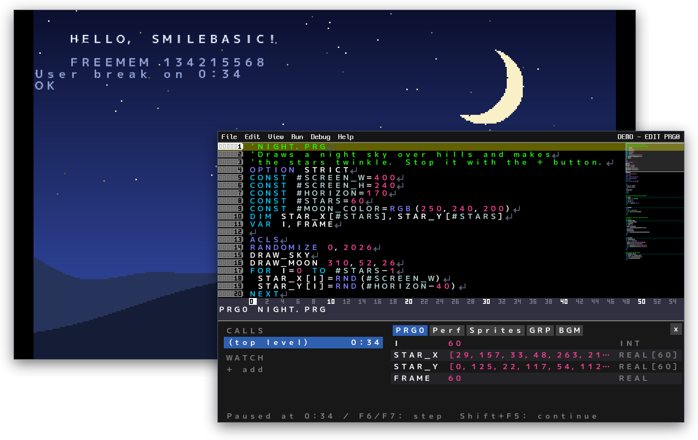

# SmileBASIC emulator

English | [한국어](README_ko.md) | [日本語](README_ja.md)

An emulator for SmileBASIC 4 (Nintendo Switch) programs, written in Rust with
SDL3. Still in development.

This is an unofficial project. SmileBoom and Nintendo have no part in it and
do not endorse it. SmileBASIC and Petit Computer are trademarks of SmileBoom
Co.Ltd., and Nintendo Switch is a trademark of Nintendo.

## Features

- [x] SmileBASIC 4 compatible ([differences](docs/using/differences.md))
- [x] Debugging tools
- [x] GPU rendering
- [ ] SmileBASIC 3 and Petit Computer(DSi/WiiU)



## Official resources

SmileBASIC's font, sounds and sprites are SmileBoom's copyrighted work, so the
emulator ships stand-ins for them.

Text and music work with bundled fonts and a bundled SoundFont. Sprites are
blank.

SmileBASIC 4's own font, sprites, music and sound effects need an unencrypted
dump of the game and its update. If you bought SmileBASIC 4 and dumped your
copy, `smilebasic-import` imports them:

```sh
smilebasic-import BASE_ROMFS BASE_EXEFS UPDATE_ROMFS UPDATE_EXEFS
```

They go to `resources` in the data directory. See
[importing.md](docs/using/importing.md).

## Running

```sh
smilebasic              # start in DIRECT mode
smilebasic PROGRAM      # load PROGRAM into PRG0 and run it
smilebasic --simple-ui  # fullscreen, a list of projects, gamepad controls
```

`PROGRAM` is a SmileBASIC 4 `TXT` file or plain UTF-8 text. Its folder becomes
the current project, so the program loads and saves the files beside it
([details](docs/using/differences.md#a-programs-own-folder)).

The emulator keeps its data here:

- Windows: `%APPDATA%\smilebasic-emulator`
- Linux: `~/.local/share/smilebasic-emulator`
- macOS: `~/Library/Application Support/smilebasic-emulator`

Projects are folders in `projects` there. Programs are saved as plain UTF-8
text, and the project manager imports and exports SmileBASIC 4's own files.

## Keys

The keys follow SmileBASIC 4, plus some that the emulator adds.

| Key | What it does |
|---|---|
| F1 | Help for the command at the cursor |
| F4 | Switch between DIRECT mode and the editor |
| F5 | Run the program, or stop it |
| F8 | Menu bar and pause |
| F12 | Projects |
| Ctrl+Shift+F11 | Fullscreen |

[shortcuts.md](docs/using/shortcuts.md) has the rest.

Gamepads work as controllers 1 to 4. With no gamepad, the keyboard is
controller 1; to turn that off, clear Run > Use the keyboard as a controller
in the menu bar.

## Documentation

[docs/index.md](docs/index.md) lists the documents, including the ones on
building from source.

## AI disclosure

Most of this project's code and documents were written by an AI (Anthropic's
Claude). A person set the direction, made the design decisions and ran the
tests on real hardware. Commits the AI took part in end with a
`Co-Authored-By:` line.

## License

Licensed under either of [MIT](LICENSE-MIT) or [Apache-2.0](LICENSE-APACHE)
(`MIT OR Apache-2.0`), at your option. Unless you state otherwise, any
contribution you intentionally submit for inclusion is dual-licensed the same
way, with no additional terms or conditions.

The bundled fonts below are under the SIL Open Font License 1.1:
- `crates/sb-runtime/fonts/fusionpixel`
- `crates/sb-runtime/fonts/galmuri`
- `crates/sb-runtime/fonts/mplus`
- `crates/sb-runtime/fonts/neodgm`
- `crates/sb-runtime/fonts/notosanssc`
- `crates/sb-runtime/fonts/unifont`

Misaki Gothic 2nd in `crates/sb-runtime/fonts/misaki` is under its author's
license, in `LICENSE.txt`.
Izumi Gothic 16 in `crates/sb-runtime/fonts/izumi` is equivalent to public
domain by its author's declaration, in `LICENSE.txt`.
GeneralUser GS in `crates/sb-sdl/sounds` is under its own license, in
`GeneralUser-GS-LICENSE.txt`.

[THIRD-PARTY-NOTICES.txt](THIRD-PARTY-NOTICES.txt) holds the license texts of these, and of the Rust
crates and SDL that the binaries link. It goes with every binary that is
given out; `tools/third_party_notices.py` writes it.
