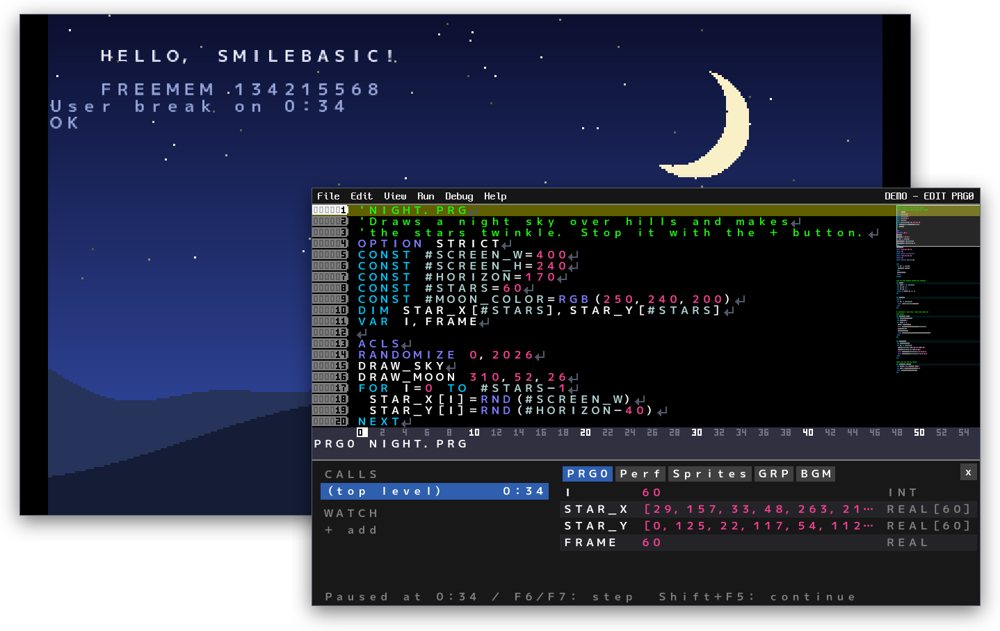

# SmileBASIC エミュレーター

[English](README.md) | [한국어](README_ko.md) | 日本語

Rust と SDL3 で書かれた、プチコン4 SmileBASIC (Nintendo Switch) 互換のエミュレーターです。
まだ開発中です。

非公式のプロジェクトであり、SmileBoom および任天堂とは関係がなく、承認や支援も受けていません。
プチコン、SmileBASIC は株式会社スマイルブームの商標、Nintendo Switch は任天堂の商標です。


## 機能

- [x] プチコン4 SmileBASIC 互換 ([differences](docs/using/differences.md))
- [x] デバッグ機能
- [x] GPU による描画
- [ ] プチコン3号およびプチコン(DSi/WiiU)互換




## 公式リソース

プチコンのフォント・サウンド・スプライトはSmileBoomの著作物であり、著作権の保護の観点から代替しています。

同梱のフォントと SoundFont で文字と音楽は動作します。スプライトは空の画像になります。

プチコン4のフォント、スプライト、音楽・効果音を使うには、プチコン4本体とアップデートの暗号化されていないダンプが必要です。
プチコン4を購入してご自身でダンプした場合は、`smilebasic-import` で公式リソースを取り込めます。

```sh
smilebasic-import <本体の ROMFS フォルダー> <本体の EXEFS フォルダー> <アップデートの ROMFS フォルダー> <アップデートの EXEFS フォルダー>
```

取り込んだリソースは `<データフォルダー>/resources` に保存されます。
詳しくは [docs/using/importing.md](docs/using/importing.md) をご覧ください。


## 実行方法

```sh
# DIRECT モードで起動
smilebasic

# 指定したファイルを PRG0 に読み込んで実行
smilebasic PROGRAM

# 全画面、プロジェクト一覧、ゲームパッド操作 (Simple UI)
smilebasic --simple-ui
```

プチコン4の TXT ファイル、または UTF-8 のテキストファイルに対応しています。
ファイルのあるフォルダーがカレントプロジェクトになるので、プログラムは同じフォルダーのファイルを読み書きできます ([詳細](docs/using/differences.md#a-programs-own-folder))。


データは次の場所に保存されます。
- Windows: `%APPDATA%\smilebasic-emulator`
- Linux: `~/.local/share/smilebasic-emulator`
- macOS: `~/Library/Application Support/smilebasic-emulator`

プロジェクトはデータフォルダーの `projects` にフォルダーとして保存されます。
プログラムは UTF-8 のテキストで保存され、プロジェクト管理画面でプチコン4形式の読み込みと書き出しができます。


## ショートカットキー

基本的にプチコン4のキー操作に従い、エミュレーター独自のキーもいくつかあります。

| キー | 動作 |
|---|---|
| F1 | カーソル位置の命令のヘルプ |
| F4 | DIRECT モード / 編集モードの切り替え |
| F5 | プログラムの実行/中断 |
| F8 | 一時停止/メニューバーの表示 |
| F12 | プロジェクト一覧を開く |
| Ctrl+Shift+F11 | 全画面 |

そのほかのキーは [Shortcuts](docs/using/shortcuts.md) をご覧ください。


ゲームパッドにも対応しており(コントローラー 1〜4)、ゲームパッドを接続しなくてもキーボードで操作できます。
キーボードをコントローラーとして使いたくない場合は、メニューバーの `Run` -> `Use the keyboard as a controller` をオフにしてください。


## ドキュメント

ドキュメントの一覧は [docs/index.md](docs/index.md) にあります。ソースからのビルド方法もそこにあります。


## AI の利用について

このプロジェクトのコードとドキュメントの大部分は、AI (Anthropic の Claude) が書いたものです。
方針と設計の判断、実機でのテストは人が行いました。
AI が関わったコミットには `Co-Authored-By:` の行が付いています。


## License

Licensed under either of [MIT](LICENSE-MIT) or [Apache-2.0](LICENSE-APACHE)
(`MIT OR Apache-2.0`), at your option. Unless you state otherwise, any
contribution you intentionally submit for inclusion is dual-licensed the same
way, with no additional terms or conditions.

The bundled fonts below are under the SIL Open Font License 1.1:
- `crates/sb-runtime/fonts/fusionpixel`
- `crates/sb-runtime/fonts/galmuri`
- `crates/sb-runtime/fonts/mplus`
- `crates/sb-runtime/fonts/neodgm`
- `crates/sb-runtime/fonts/notosanssc`
- `crates/sb-runtime/fonts/unifont`

Misaki Gothic 2nd in `crates/sb-runtime/fonts/misaki` is under its author's
license, in `LICENSE.txt`.
Izumi Gothic 16 in `crates/sb-runtime/fonts/izumi` is equivalent to public
domain by its author's declaration, in `LICENSE.txt`.
GeneralUser GS in `crates/sb-sdl/sounds` is under its own license, in
`GeneralUser-GS-LICENSE.txt`.

[THIRD-PARTY-NOTICES.txt](THIRD-PARTY-NOTICES.txt) holds the license texts of these, and of the Rust
crates and SDL that the binaries link. It goes with every binary that is
given out; `tools/third_party_notices.py` writes it.
